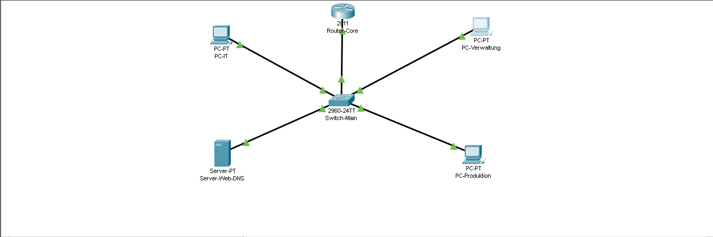
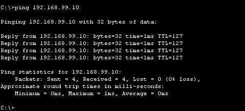
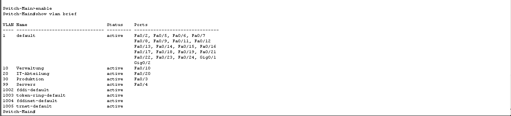
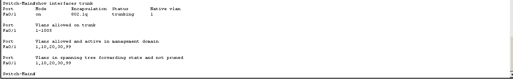

# Cisco Enterprise Network – VLANs & Inter-VLAN Routing

## Projektbeschreibung

In diesem Projekt habe ich mit Cisco Packet Tracer ein kleines Unternehmensnetzwerk geplant, aufgebaut und konfiguriert. Ziel war es, verschiedene Abteilungen mithilfe von VLANs logisch voneinander zu trennen und die Kommunikation zwischen den Netzwerken über Inter-VLAN-Routing zu ermöglichen.

Das Projekt dient dazu, meine praktischen Kenntnisse im Bereich Netzwerktechnik und meine Vorbereitung auf die Ausbildung zum Fachinformatiker für Systemintegration zu dokumentieren.

## Verwendete Technologien

- Cisco Packet Tracer
- Cisco Router und Switch
- VLAN-Konfiguration
- IEEE 802.1Q-Trunking
- Inter-VLAN-Routing (Router-on-a-Stick)
- IPv4-Adressierung und Standard-Gateways
- Netzwerkdiagnose mit `ping`

## Netzwerkstruktur

| VLAN | Abteilung | Netzwerk | Gateway |
|---|---|---|---|
| 10 | Verwaltung | `192.168.10.0/24` | `192.168.10.1` |
| 20 | IT-Abteilung | `192.168.20.0/24` | `192.168.20.1` |
| 30 | Produktion | `192.168.30.0/24` | `192.168.30.1` |
| 99 | Server | `192.168.99.0/24` | `192.168.99.1` |

## Technische Umsetzung

- Vier VLANs für unterschiedliche Abteilungen und den Serverbereich erstellt
- Switch-Ports den entsprechenden VLANs zugeordnet
- 802.1Q-Trunk zwischen Switch und Router eingerichtet
- Router-Subinterfaces für das Inter-VLAN-Routing konfiguriert
- IPv4-Adressen und Standard-Gateways für die Endgeräte eingerichtet
- Konnektivität zwischen den VLANs mit `ping` überprüft

## Netzwerktopologie

## Testergebnisse

Die folgenden Verbindungen wurden erfolgreich mit `ping` getestet:

- PC-Verwaltung → Gateway `192.168.10.1`
- PC-Verwaltung → PC-IT `192.168.20.12`
- PC-Produktion → PC-Verwaltung `192.168.10.11`
- PC-Verwaltung → Server `192.168.99.10`
- Server → Gateway `192.168.99.1`

### Ping-Test zum Server

## VLAN-Konfiguration

## Trunk-Konfiguration

## Projektdateien

- `cisco-enterprise-network-fisi-final.pkt` – Packet-Tracer-Projektdatei
- `screenshots/` – Screenshots der Netzwerktopologie, Konfigurationen und Tests

## Was ich gelernt habe

Durch dieses Projekt habe ich praktische Erfahrungen mit VLANs, 802.1Q-Trunking, IPv4-Adressierung, Inter-VLAN-Routing und der systematischen Fehlersuche in Netzwerken gesammelt.

Ich möchte diese Kenntnisse während meiner Ausbildung zum Fachinformatiker für Systemintegration weiter vertiefen.
